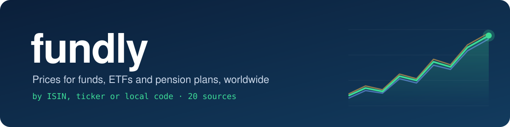
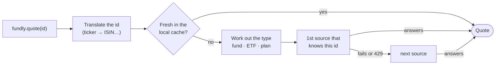

<p align="center">
  
</p>

<p align="center">
  <a href="https://github.com/antooro/fundly/actions/workflows/tests.yml"></a>
  
  
  
  
  
</p>

<p align="center">
  <b>One Python call for the price of any mutual fund, ETF or pension plan in the world.<br>
  Look it up by ISIN, ticker or its local code; no API keys, no accounts.</b>
</p>

<p align="center">
  Over <b>350,000 funds</b> and <b>38,000 ETF listings</b> worldwide, plus <b>45,000+ funds and pension plans</b> from national sources.
</p>

---

```python
import fundly

fundly.quote("VTSAX").price                  # 182.82     US mutual fund, by ticker
fundly.quote("ES0112611001").price           # 367.82113  Spanish fund, by ISIN
fundly.quote("cl-afp:HABITAT-A").price       # 100365.02  Chilean pension fund, local code
fundly.history("INF179K01XQ0").to_pandas()   # Indian fund, daily history as a pandas Series
```

## Why fundly

Ticker-based tools leave most of the world's savings out: European share classes, Indian schemes, Chilean AFPs, Spanish pension plans. fundly starts from the identifiers people actually have, asks several sources, and tells you exactly what kind of price you got.

|  | **fundly** | yfinance | mstarpy |
|---|:---:|:---:|:---:|
| Look up by **ISIN** | ✅ | via search | via search |
| **Local codes** (AMFI, CAFCI, AFP, DGS…) | ✅ | ❌ | ❌ |
| **Pension plans** in 7 countries | ✅ | ❌ | ❌ |
| Says whether a price is **NAV, exchange close or index** | ✅ | ❌ | ❌ |
| **Several sources** with automatic fallback | ✅ | ❌ | ❌ |
| **Cross-check** sources side by side | ✅ | ❌ | ❌ |
| Needs a browser / Selenium | no | no | yes (v10+) |

## Install

```bash
pip install fundly              # pip install "fundly[pandas]" for .to_pandas()
```

## A quick tour

**Search by name, in any language.** Every word counts, in any order, accents optional:

```python
for f in fundly.search("emaxis slim", limit=3):
    print(f.id, f.name)
# JP90C000PZY9 MUAM eMAXIS Slim All US Equity
# JP90C000G7W3 MUAM eMAXIS Slim All World Eq 3 Reg Eql
# JP90C000H1T1 MUAM eMAXIS Slim All Wld Eq All Country

[f.id for f in fundly.search("superfondo acciones", limit=3)]
# ['ar-cafci:148', 'ar-cafci:304', 'ar-cafci:1373']
```

**Any identifier lands on the same fund.** Tickers and local codes are translated to the ISIN when one exists, so caching and cross-checking work across them:

```python
fundly.quote("in-amfi:118989").id                       # 'INF179K01XQ0'  (AMFI scheme code → ISIN)
fundly.quote("VOO").id, fundly.instrument("VOO").type    # ('US9229083632', 'etf')
```

**Daily history**, straight into pandas:

```python
fundly.history("N5508", start="2026-10-01").to_pandas().tail(3)    # Spanish pension plan
# date
# 2026-10-21    134.58548
# 2026-10-22    133.59280
# 2026-10-23    133.50458
```

**Cross-check every source.** Independent feeds agreeing to the last decimal is how you know a price is right:

```python
c = fundly.compare("ES0173311103")    # Renta 4 Numantia Patrimonio Global
for q in c.quotes:
    print(f"{q.source:<12} {q.price:>9} {q.currency} {q.date}")
# morningstar    29.3605 EUR 2026-10-23
# finect        29.00609 EUR 2026-10-21
# ft             29.3605 EUR 2026-10-23
# quefondos     29.41016 EUR 2026-10-22
# yahoo          29.4102 EUR 2026-10-22

c.nav_spread_pct    # 0.0  (spread between sources that share the latest date)
```

**Know what kind of price you got.** Every quote says whether it is an official NAV, an exchange close, or an index rebuilt from published returns:

```python
fundly.quote("IE00B4L5Y983").price_type                         # 'nav'     iShares Core MSCI World: issuer NAV
fundly.quote("IE00B4L5Y983", source="morningstar").price_type   # 'market'  exchange close
fundly.quote("il-gemel:880").price_type                         # 'index'   Israeli fund: monthly returns only
```

**Spot bad data instead of trusting it blindly.** A price older than expected is flagged `stale`; one far from what other sources said in the last month is checked against the next source and replaced or flagged `suspicious`. Histories note isolated spikes and ×100 jumps:

```python
q = fundly.quote("ar-cafci:3906")    # Argentine agro fund that stopped reporting
q.stale, q.age_days, q.warnings
# (True, 90, ('stale: last price is 90 days old (2026-07-31)',))

q.to_dict()    # every result is JSON-ready
# {'id': 'ar-cafci:3906', 'name': 'ADBlick Granos Plus FCIC', 'price': 0.488829, 'date': '2026-07-31', ...}
```

**Value everything in one currency.** Prices come in each fund's own currency; ask for another and fundly converts at the ECB reference rate of the price's date, keeping the original figure:

```python
q = fundly.quote("INF179K01XQ0", currency="EUR")    # Indian fund, in euros
round(q.price, 4), q.original_price, q.original_currency, round(q.fx_rate, 6), q.fx_source
# (2.0377, 216.123, 'INR', 0.009428, 'ecb')

fundly.history("VTSAX", start="2025-01-01", currency="EUR")    # each day at that day's rate
```

## Coverage

Real quotes taken with fundly in October and November 2026:

| Market | Example id | What it is | Latest | Source |
|---|---|---|---|---|
| 🌍 Worldwide funds | `ZAE000025029` | Allan Gray Balanced A | 201.67 ZAR | Morningstar |
| 🌍 Worldwide ETFs | `VOO` → `US9229083632` | Vanguard S&P 500 ETF | 703.41 USD (market) | Morningstar |
| 🇺🇸 US mutual funds | `VTSAX` | Vanguard Total Stock Market Admiral | 182.82 USD | Morningstar |
| 🇪🇸 Spanish funds | `ES0112611001` | Azvalor Internacional FI | 367.82 EUR | Morningstar, Finect, FT, Quefondos |
| 🇪🇸 Spanish pension plans | `N5508` | Santander Autónomos RVM PPES | 133.50 EUR | Finect, comparadorfondos |
| 🇬🇧 UK pension & life funds | `ft:0P00009VB8` | Aviva Pension Invesco Emerging Markets | 2.53 GBP | FT |
| 🇵🇱 Poland (funds, PPK, OFE) | `pl-analizy:ARK52` | Erste PPK 2050 | 2,439.80 PLN | analizy.pl |
| 🇮🇳 India mutual funds | `in-amfi:118989` | HDFC Mid Cap Direct Growth | 216.12 INR | AMFI (official) |
| 🇮🇳 India NPS pensions | `in-nps:SM001001` | SBI Pension Fund, Central Govt | 49.36 INR | npsnav.in |
| 🇨🇳 China | `cn:110022` | 易方达消费行业股票 | 2.79 CNY | Eastmoney |
| 🇯🇵 Japan | `JP90C000H1T1` | eMAXIS Slim All Country | 37,441 JPY | Morningstar |
| 🇻🇳 Vietnam | `vn-fmarket:VFF` | VinaCapital Enhanced Bond | 27,154.70 VND | fmarket |
| 🇮🇩 Indonesia | `IDN000007002` | Simpan Balanced | 944.27 IDR | Morningstar, Pasardana, fund managers |
| 🇨🇱 Chile pension funds | `cl-afp:HABITAT-A` | AFP Habitat, Fund A | 100,365.02 CLP | Superintendencia de Pensiones |
| 🇨🇴 Colombia pensions & funds | `co-pension:10-6000` | Colfondos, higher-risk fund | 97,116.41 COP | datos.gov.co |
| 🇧🇷 Brazil funds | `br-cvm:00017024000153` | Renda fixa class | 45.26 BRL | CVM (official open data) |
| 🇦🇷 Argentina funds | `ar-cafci:148` | Superfondo Acciones, Clase A | 486.53 ARS | CAFCI, argentinadatos |
| 🇮🇱 Israel provident & pension | `il-gemel:880` | Meitav Hishtalmut General | index | Gemel-net (gov) |
| 🇹🇷 Turkey funds & BES pensions | `tr-tefas:YAC` | Yapı Kredi Portföy İkinci Fon Sepeti | 14.09 TRY | TEFAS (official) |
| 🇵🇪 Peru mutual funds | `pe-smv:38036-0002` | BBVA Renta Mediano Plazo Soles | 412.62 PEN | SMV (official) |
| 🇲🇽 Mexico funds & AFORE pensions | `MX54PR1Y0001` | Profuturo SIEFORE 70-74 (PROF-70 A-I) | 17.74 MXN | Morningstar |
| 🇵🇭 Philippine bank trust funds | `ph-uitf:69` | BPI Philippine Equity Index Fund | 83.53 PHP | uitf.com.ph |

**Tested at random:** in 326 funds, ETFs and pension plans drawn at random from 15 universes (worldwide Morningstar pages, AMFI, CAFCI, CVM, Chilean AFPs, Spanish plans…), **96% returned a price** and none raised an unexpected error. The misses were mostly funds that have since closed but are still listed.

Morningstar alone reaches funds and ETFs in most countries (US, Canada, Mexico, Europe, Japan, Korea, Taiwan, Hong Kong, Singapore, Thailand, Malaysia, Australia, South Africa, the Gulf…), including Mexican AFORE pension funds (search `afore profuturo`) and Hong Kong MPF funds. The national sources add official data and products Morningstar doesn't carry. Not covered yet: Peruvian AFP pensions, Philippine mutual funds and some Australian superannuation funds (AustralianSuper, UniSuper, Cbus); their public data sits behind bot protection.

**History depth.** Argentine funds have daily history from January 2020 for every class, from the argentinadatos.com community mirror of the regulator's (CNV) daily sheets. Indonesian funds get full history since launch from Morningstar (about a third of them), or from the manager's own site for seven managers (about 190 more funds, some back to 1996). Others have Pasardana's last 12 months: older data is a paid product everywhere we looked. Turkish funds have 5 years (TEFAS's limit). Peruvian funds go back to launch; a series of a multi-series fund costs one request per day, so it covers its last two months. Philippine trust funds give today's price only (the site's history sits behind a captcha). With the cache on, fundly keeps every Indonesian, Argentine and Philippine price it downloads, so those histories grow on your machine instead of sliding along.

## Identifiers

| You type | Means | Example |
|---|---|---|
| ISIN | any fund or ETF | `IE00B4L5Y983` |
| ticker | listed ETF or US/CA mutual fund | `VTSAX`, `ticker:VOO` |
| `N####` · `S####` | Spanish pension plan · employment sub-plan (DGS code) | `N5508`, `S0156` |
| `ms:` | Morningstar id, for funds without ISIN (Korea, China…) | `ms:F00001H9R0` |
| `ft:` | FT symbol, for UK pension/life funds | `ft:0P00009VB8` |
| `in-amfi:` · `in-nps:` | India scheme code · NPS scheme | `in-amfi:118989` |
| `cn:` | Chinese fund code | `cn:110022` |
| `cl-afp:` | Chilean AFP + fund letter | `cl-afp:HABITAT-A` |
| `co-pension:` · `co-fic:` | Colombia entity–fund · collective fund | `co-pension:10-6000` |
| `br-cvm:` | Brazilian CNPJ (digits) | `br-cvm:00017024000153` |
| `ar-cafci:` | CAFCI class code | `ar-cafci:148` |
| `pl-analizy:` | analizy.pl code | `pl-analizy:PZU50` |
| `il-gemel:` · `il-pensia:` | Israeli fund id | `il-gemel:880` |
| `vn-fmarket:` · `id-pasardana:` | Vietnam fund code · Pasardana id | `vn-fmarket:VFF` |
| `tr-tefas:` | TEFAS fund code (Turkey) | `tr-tefas:YAC` |
| `pe-smv:` | SMV manager–fund code, plus series (Peru) | `pe-smv:38036-0002`, `pe-smv:151229-0004-B` |
| `ph-uitf:` | uitf.com.ph fund id (Philippines) | `ph-uitf:69` |

Results always carry a canonical `id`: the ISIN when there is one, otherwise `scheme:code`.

## How it works



- **Each source only gets the ids it understands.** National sources answer for their own codes; Morningstar, FT and Yahoo for ISINs and tickers.
- **Priority depends on the product.** ETFs go to the official NAV first, Indian funds to AMFI first, and pension plans to the portals that carry them.
- **If a source fails, the next one answers.** Rate-limited sources are paused, not hammered.
- **Search only asks who can answer.** An ISIN or a local code is looked up directly. Text goes to the worldwide sources, plus national ones whose words appear in it ("afp" → Chile, "hdfc" → India…); Chinese, Hebrew and Vietnamese text go straight to the sources that publish names in that script. Other national catalogues are only tried when nothing matches every word. Results are ranked by how well the name matches, then by fund size.
- **Bad data is flagged, not hidden.** A price far from the last month's prices from other sources (a ×100 unit error, a wrong share class) makes fundly ask the next source; whichever two agree wins, and the quote says what was replaced. Old prices are marked `stale` (10 days; 45 for monthly series).
- **Local cache** in your platform's cache folder (`~/.cache/fundly` on Linux, `~/Library/Caches/fundly` on macOS, `%LOCALAPPDATA%\fundly\Cache` on Windows; or `$FUNDLY_CACHE_DIR`): quotes are reused for 6 h, history and searches for 24 h. The catalogue starts empty and only grows with what you look up. Bulk files (Brazil's monthly CVM archives, Argentine history files) are kept there too and revalidated with the server, so a later session downloads only what changed.

## API

| Call | Returns |
|---|---|
| `fundly.search(q, type=None, category=None, live=True, limit=20)` | `list[Instrument]` |
| `fundly.instrument(id)` | `Instrument` (name, type, currency, domicile, provider, category, TER, size, other ids) |
| `fundly.quote(id, source=None, currency=None)` | `Quote` (price, date, currency, `price_type`, source, `warnings`, `stale`, `suspicious`, `age_days`; plus the original price and FX rate if converted) |
| `fundly.history(id, start=None, end=None, source=None, currency=None)` | `History`, with `.points`, `.warnings` and `.to_pandas()` |
| `fundly.compare(id)` | `Comparison`, with every source's quote (the odd one out flagged `suspicious`) and `nav_spread_pct` |

Every result has `.to_dict()`, with dates as ISO strings, ready for `json.dumps`.

For custom settings, create your own client:

```python
from fundly import Client

with Client(cache="~/data/fundly", min_interval=1.0, max_wait=60) as fl:
    fl.history("IE00B4L5Y983", start="2015-01-01")
```

- `min_interval`: seconds between two requests to the same site (default 0.5).
- `max_wait`: total seconds one call may take across every source it tries (default 120; `None` for no limit, e.g. for many years of Brazilian history, whose first download takes a while; if a call times out, the download carries on in the background and the next call finds it on disk). A hanging site can't hold your program beyond it.
- `exclude`: sources to leave out.

Errors: `InvalidId`, `NotFound`, `UnknownSource`, `FXUnavailable` and `FundlyTimeout`, all subclasses of `FundlyError`. Source fallbacks are logged on the `fundly` logger.

### Currencies

- Prices are always in the share class's **own currency**, never silently converted. Prices quoted in pence, cents or agorot (GBp/GBX, ZAc, ILA) are turned into pounds, rand and shekels.
- With `currency="EUR"` (or any ISO code) the price is converted through the euro at the **rate in force on the price's date**; weekends and holidays use the last published rate. History converts each day with its own rate.
- Rates are **ECB euro reference rates** (29 currencies, source: ECB). Currencies the ECB doesn't publish (ARS, CLP, COP, VND, TWD…) come from Yahoo Finance. Converted quotes keep `original_price`, `original_currency`, `fx_rate`, `fx_date` and `fx_source`, so a converted price is never mistaken for a native one.

## Sources

| Source | Covers | Data |
|---|---|---|
| Morningstar | Funds & ETFs worldwide, search | NAV / exchange close |
| Finect | Spanish & EU funds, ETF NAVs, Spanish plans | NAV |
| Financial Times | Funds & ETFs, UK pension funds | NAV / exchange close |
| Quefondos | Spanish funds & plans | latest NAV |
| comparadorfondos | Spanish pension plans | NAV |
| Yahoo Finance | Funds & ETFs (fallback) | NAV / exchange close |
| AMFI (+ mfapi.in history) | India mutual funds | NAV, official |
| npsnav.in | India NPS pensions | NAV |
| Eastmoney | China funds | NAV |
| Superintendencia de Pensiones | Chile AFP funds A–E | NAV, official |
| datos.gov.co | Colombia pensions & collective funds | NAV, official |
| CVM open data | Brazil funds | NAV, official (ODbL) |
| CAFCI (+ argentinadatos.com history) | Argentina funds | NAV, official |
| analizy.pl | Poland funds, PPK, OFE | NAV |
| Gemel-net / Pensia-net | Israel provident & pension funds | index from monthly returns, official |
| fmarket | Vietnam funds | NAV |
| Pasardana | Indonesia funds | NAV, last 12 months of history |
| Batavia, Trimegah, Avrist, Syailendra, Samuel, Henan Putihrai, Korea Investment | Their Indonesian funds | full NAV history, from each manager's site |
| TEFAS | Turkey funds, BES pension funds, ETFs | NAV, official, 5 years of history |
| SMV | Peru mutual funds | NAV, official |
| uitf.com.ph (Trust Officers Association) | Philippine bank trust funds (UITF) | latest NAV; history builds up locally |

## Responsible use

fundly is an independent, source-available project, **not affiliated with any of the sites above**. All data belongs to its owners.

- **No data ships with fundly.** Every request goes from your machine to the public website, as if you visited it, and you are responsible for following each site's terms of use.
- **Personal, non-commercial use.** Most of these sites allow personal use and **forbid redistributing or reselling their data**. Don't use fundly to build a data feed, a paid API or any service that republishes it.
- **robots.txt.** Morningstar, Finect, Yahoo, npsnav.in, analizy.pl and Gemel-net ask automated clients to stay away in their robots.txt, and uitf.com.ph asks for 60 s between requests (fundly waits 2 s there). Like yfinance, fundly uses them by default. If you prefer to respect robots.txt strictly, leave them out:
  ```python
  Client(exclude=["morningstar", "finect", "yahoo", "npsnav", "analizy", "gemelnet", "uitf"])
  ```
- **TEFAS.** Its web pages, robots.txt included, refuse non-browser clients, while its public API answers normally, so its terms can't be read. fundly calls only the API; leave it out with `Client(exclude=["tefas"])` if in doubt.
- **Gentle by default.** At most one request every 0.5 s per site, cached results, and a pause whenever a site answers *429 Too Many Requests*.
- **Honest.** fundly identifies itself in its `User-Agent` and never bypasses anti-bot protection. Sites that block automated clients are not supported.
- **No advice.** Prices can be late, missing or wrong. Nothing here is investment advice, and the software comes with no warranty.

If you run one of these sites and want it out of fundly, open an issue.

## License

fundly is released under the [PolyForm Noncommercial License 1.0.0](LICENSE).

- ✅ **Free** for personal use, research, education, hobby projects, and non-profit, educational and government organisations.
- ❌ **No commercial use.** You can't sell it, include it in a paid product or service, or use it inside a business.

Because it forbids commercial use, fundly is *source-available*, not "open source" in the OSI sense.

## Contributing

```bash
uv sync
uv run pytest            # 595 offline tests: parsers, client, currencies, broken sites, properties, concurrency
uv run pytest -m live    # 87 tests against the real sites
```

Adding a country is one class with `get_quote`, `get_history` and, optionally, `search`, plus an id scheme registered in `fundly.ids`. See `fundly/sources/`.

---

<sub>🌍 <b>En español:</b> fundly consulta el valor liquidativo de fondos de inversión, ETFs y planes de pensiones de todo el mundo por ISIN, ticker o código local, cruzando varias fuentes. Licencia PolyForm Noncommercial: uso personal y no comercial; no redistribuye datos.</sub>
